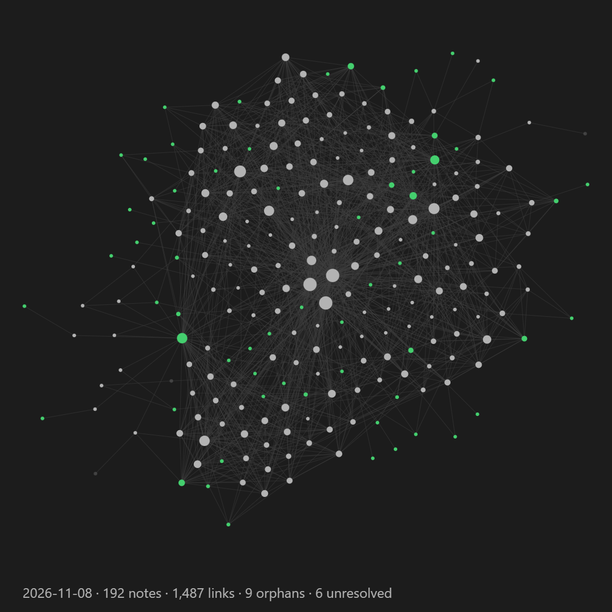

# Graph Timelapse

**A history of your Obsidian graph, recorded as it happens, and played back as a timelapse in any note.**

Graph Timelapse is an Obsidian plugin that records what your graph view actually looks like on a schedule: every note, every link, every tag, where each one sits. It turns that history into an animation you can embed in a note (a home page, a project page) and into crisp PNG keyframes you can share.

Obsidian's built-in graph *Animate* button replays your **current** notes in the order of their file dates. It can't show links you added later, notes you deleted or renamed, or how clusters formed. Graph Timelapse keeps the real record.

Made by [Shady Knoll Labs](https://shadyknolllabs.com): focused, trustworthy tools, the kind we rely on ourselves.



## Quick start

1. Install and enable **Graph Timelapse**.
2. Run **Graph Timelapse: Take graph snapshot now** from the command palette (Ctrl/Cmd+P).
3. Add this to any note:

   ````markdown
   ```graph-timelapse
   mode: loop
   ```
   ````

From then on it records once a day by itself. The animation needs at least two snapshots, so it starts moving from day two.

## How it works

- **Records what your graph actually looked like.** On a schedule (default: daily) the plugin briefly opens the graph view, reads every note's position, size and colour plus every link, and saves it as a small JSON snapshot. Obsidian's built-in *Animate* replays file dates; this records real history: links added later, deleted and renamed notes, tags and unresolved links.
- **Steady layouts.** Obsidian lays the graph out from scratch each time, so each snapshot is rotated/mirrored/shifted to best match the previous one. Notes stay put; new ones appear.
- **Embed it anywhere.** Put a `graph-timelapse` code block in any note (a home page, say) and it plays the history as a smooth animation: notes glide, new ones fade in. Click to pause.
- **PNG keyframes.** Every so often (default: weekly) a PNG is saved, drawn from the data, so it's crisp at any size. Any snapshot can be rendered later with **Render PNG from a snapshot**.
- **Private by default.** Snapshots store notes as anonymous ids unless you turn on *Store note titles*. Nothing leaves your vault.

### Embed

````markdown
```graph-timelapse
mode: loop        # loop | once | still
from: 2026-11-01  # optional
speed: 2          # snapshots per second
hold: 2           # seconds on the last frame
height: 420
stamp: true
```
````

For a single snapshot: `mode: still` and `date: latest` (or `date: 2026-11-08`).

### Sizes

A snapshot of a ~200-note vault is about 50 KB of text, one node or link per line, so Git diffs and compresses it well. PNGs (~450 KB each) are the bulk, which is why they're keyframes rather than daily.

## Commands

| Command | What it does |
|---|---|
| **Take graph snapshot now** | Records the graph and saves a PNG right away |
| **Render PNG from a snapshot** | Pick any saved day and draw its PNG |

## Settings

| Setting | Default | |
|---|---|---|
| Automatic snapshots | on | |
| Record graph data every | 1 day | Minutes, hours, days, weeks, months or years. Minimum 30 minutes |
| Save a PNG every | 1 week | 0 = never |
| Time of day | `00:00` | For day-or-longer schedules: first time the vault is open at or after this |
| Data folder | `_attachments/graph-data` | One JSON file per snapshot |
| Store note titles | off | Off: notes are anonymous ids |
| Image folder / file name | `_attachments` / `graph-{{date}}` | |
| Shape | Square 1080 × 1080 | Also 800², 4:5, 9:16, 16:9 or custom |
| Padding, background, stamp | 40 px, theme, on | |
| Log counts to CSV | on | `_attachments/graph-stats.csv`, one row per day |


## Using it with Git

If your vault is backed up with the Git plugin, snapshots are committed on its next auto commit-and-sync. If your `.gitignore` ignores the attachments folder, allow these files back in:

```gitignore
_attachments/*
!_attachments/graph-*.png
!_attachments/graph-stats.csv
!_attachments/graph-data/
```

## Making a video

The embed is the easiest way to watch it. To make a video file from the PNG keyframes, use [ffmpeg](https://ffmpeg.org/) from the image folder:

```sh
ffmpeg -framerate 4 -pattern_type glob -i "graph-*.png" -c:v libx264 -pix_fmt yuv420p timelapse.mp4
```

## Compatibility

Obsidian doesn't offer a public API for the graph view, so the plugin reads node positions from its internals, carefully. If a future Obsidian update changes them, it falls back to capturing the graph as an image (no data for that day) instead of failing, and records what happened in `last-capture.json` in the plugin folder.

Desktop is the tested platform. Recording briefly opens the graph view in a tab and closes it again.

## Support

Graph Timelapse is free and open source. If it's useful to you:

[☕ Buy me a coffee](https://buymeacoffee.com/shadyknollm)

Made by [Shady Knoll Labs](https://shadyknolllabs.com).

## Development

See [docs/HOW-PLUGINS-WORK.md](docs/HOW-PLUGINS-WORK.md) and [docs/RELEASING-AND-PATCHING.md](docs/RELEASING-AND-PATCHING.md).

## License

MIT
