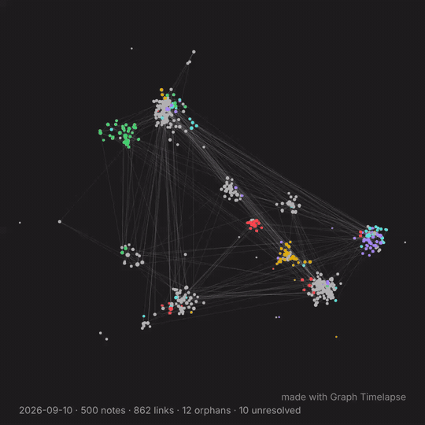

# Graph Timelapse

**A history of your Obsidian graph, recorded as it happens, and played back as a timelapse in any note.**

Graph Timelapse is an Obsidian plugin that records what your graph view actually looks like on a schedule: every note, every link, every tag, where each one sits. It turns that history into an animation you can embed in a note (a home page, a project page) and into crisp PNG keyframes you can share.

Obsidian's built-in graph *Animate* button replays your **current** notes in the order of their file dates. It can't show links you added later, notes you deleted or renamed, or how clusters formed. Graph Timelapse keeps the real record.

Made by [Shady Knoll Labs](https://shadyknolllabs.com): focused, trustworthy tools, the kind we rely on ourselves.



*60 days of a 1,000-note vault, made with **Export timelapse video** (new in 0.3.0). [Full-quality MP4](docs/media/graph-timelapse-1000-notes.mp4) · [vertical 9:16 for Shorts/Reels](docs/media/graph-timelapse-1000-notes-vertical.mp4) · [steady playback, before / after](docs/media/graph-timelapse-steady-before-after.mp4) · [10,000-note stress test](docs/media/graph-timelapse-10000-notes.mp4). Sample data from the built-in generator ([bench/](bench/README.md)).*


## Quick start

1. Install and enable **Graph Timelapse**.
2. Run **Graph Timelapse: Take graph snapshot now** from the command palette (Ctrl/Cmd+P).
3. Add this to any note:

   ````markdown
   ```graph-timelapse
   mode: loop
   ```
   ````

From then on it records once a day by itself. The animation needs at least two snapshots, so it starts moving from day two.

## How it works

- **Records what your graph actually looked like.** On a schedule (default: daily) the plugin briefly opens the graph view, reads every note's position, size and colour plus every link, and saves it as a small JSON snapshot. Obsidian's built-in *Animate* replays file dates; this records real history: links added later, deleted and renamed notes, tags and unresolved links.
- **Steady layouts.** Obsidian lays the graph out from scratch each time, so each snapshot is rotated/mirrored/shifted to best match the previous one, and playback keeps notes close to where they were (see *Steady playback* below). Automatic captures wait until the layout has actually run and come to rest; if Obsidian is in the background and the graph doesn't animate, the capture is retried a few minutes later.
- **Embed it anywhere.** Put a `graph-timelapse` code block in any note (a home page, say) and it plays the history as a smooth animation: notes glide, new ones fade in. Click to pause.
- **PNG keyframes.** Every so often (default: weekly) a PNG is saved, drawn from the data, so it's crisp at any size. Any snapshot can be rendered later with **Render PNG from a snapshot**.
- **Private by default.** Snapshots store notes as pseudonymous ids (a hash of each note's path) unless you turn on *Store note titles*. That keeps titles out of the files, but it isn't encryption: someone who can guess a path can match its id. Nothing leaves your vault.

### Embed

````markdown
```graph-timelapse
mode: loop        # loop | once | still
from: 2026-11-01  # optional
speed: auto       # snapshots per second; auto ≈ 15 s per pass (1–8/s)
hold: 2           # seconds on the last frame
height: 420
stamp: true
steady: 0.7          # 0 = Obsidian's layouts as recorded … 0.95 = notes barely move
skip-unchanged: true # fold snapshots where no note or link changed
```
````

**Steady playback.** Obsidian lays the graph out from scratch on every capture, so even with nothing new, notes swap places. Playback (embeds and video export) keeps each note close to where it was and lets it drift only part of the way to its new spot, and new notes appear beside the notes they link to. Snapshots where no note or link changed are folded into the one before. This changes playback only: the recorded snapshots stay exactly as captured. On a real 268-note vault it cut frame-to-frame jumping from ~23% of the frame to ~8% ([before / after](docs/media/graph-timelapse-steady-before-after.mp4)).

For a single snapshot: `mode: still` and `date: latest` (or `date: 2026-11-08`).

### Export a video

**Export timelapse video** turns any range of snapshots into an MP4 (or WebM) you can post anywhere: pick the dates, the shape (square, 4:5, 9:16 for Shorts/Reels/TikTok, 16:9), speed and how long to hold the last frame. Speed defaults to **Auto**: short histories play at a readable 1 snapshot per second, longer ones speed up (to at most 8 per second) so the video stays around 15 seconds. It's saved next to your PNG keyframes as `graph-timelapse_<from>_<to>.mp4`.

- Encoded on your device with WebCodecs, frame by frame with exact timing, so it stays smooth even for very large vaults and usually renders faster than real time. Where WebCodecs isn't available it falls back to the browser's recorder.
- Every export carries a small **"made with Graph Timelapse"** credit in the corner, so people who see your video can find the plugin. It's how a free plugin gets around.
- Free, like the rest of the plugin. If it's useful, there's a ☕ link in the settings.

### Sizes

A snapshot of a ~200-note vault is about 50 KB of text, one node or link per line, so Git diffs and compresses it well. PNGs (~450 KB each) are the bulk, which is why they're keyframes rather than daily.

## Commands

| Command | What it does |
|---|---|
| **Take graph snapshot now** | Records the graph and saves a PNG right away |
| **Render PNG from a snapshot** | Pick any saved day and draw its PNG |
| **Export timelapse video** | Save a range of snapshots as an MP4/WebM video |

## Settings

| Setting | Default | |
|---|---|---|
| Automatic snapshots | on | |
| Record graph data every | 1 day | Minutes, hours, days, weeks, months or years. Minimum 30 minutes |
| Save a PNG every | 1 week | 0 = never |
| Time of day | `00:00` | For day-or-longer schedules: first time the vault is open at or after this |
| Data folder | `_attachments/graph-data` | One JSON file per snapshot |
| Store note titles | off | Off: notes are pseudonymous ids (path hashes) |
| Image folder / file name | `_attachments` / `graph-{{date}}` | |
| Shape | Square 1080 × 1080 | Also 800², 4:5, 9:16, 16:9 or custom |
| Padding, background, stamp | 40 px, theme, on | |
| Log counts to CSV | on | `_attachments/graph-stats.csv`, one row per day |


## Using it with Git

If your vault is backed up with the Git plugin, snapshots are committed on its next auto commit-and-sync. If your `.gitignore` ignores the attachments folder, allow these files back in:

```gitignore
_attachments/*
!_attachments/graph-*.png
!_attachments/graph-stats.csv
!_attachments/graph-data/
```

## Making a video

The embed is the easiest way to watch it. To make a video file from the PNG keyframes, use [ffmpeg](https://ffmpeg.org/) from the image folder:

```sh
ffmpeg -framerate 4 -pattern_type glob -i "graph-*.png" -c:v libx264 -pix_fmt yuv420p timelapse.mp4
```

## Compatibility

Obsidian doesn't offer a public API for the graph view, so the plugin reads node positions from its internals, carefully. If a future Obsidian update changes them, it falls back to capturing the graph as an image (no data for that day) instead of failing, and records what happened in `last-capture.json` in the plugin folder.

Desktop is the tested platform. Recording briefly opens the graph view in a tab and closes it again.

### Known limitations

- **Renamed or moved notes** get a new id (ids come from the path), so the timelapse shows the old one leaving and a new one arriving.
- **Layout alignment is rigid.** Each day is rotated, shifted or mirrored as a whole to match the day before. If Obsidian's layout rearranges clusters relative to each other, that part of the animation will still move.
- **If the graph internals change**, days captured by the image fallback have no data, so they appear as PNGs but not in the animation.

## Support

Graph Timelapse is free and open source. If it's useful to you:

[☕ Buy me a coffee](https://buymeacoffee.com/shadyknollm)

Made by [Shady Knoll Labs](https://shadyknolllabs.com).

## Development

```sh
npm install
npm run dev     # rebuild main.js on every change
npm test        # alignment, snapshots, transitions (Node's built-in test runner)
npm run lint    # Obsidian's official ESLint rules
npm run build   # type-check + production build
```

See [docs/HOW-PLUGINS-WORK.md](docs/HOW-PLUGINS-WORK.md), [docs/RELEASING-AND-PATCHING.md](docs/RELEASING-AND-PATCHING.md), and [docs/REVIEWS.md](docs/REVIEWS.md) for outside reviews and what changed because of them.

## License

MIT
